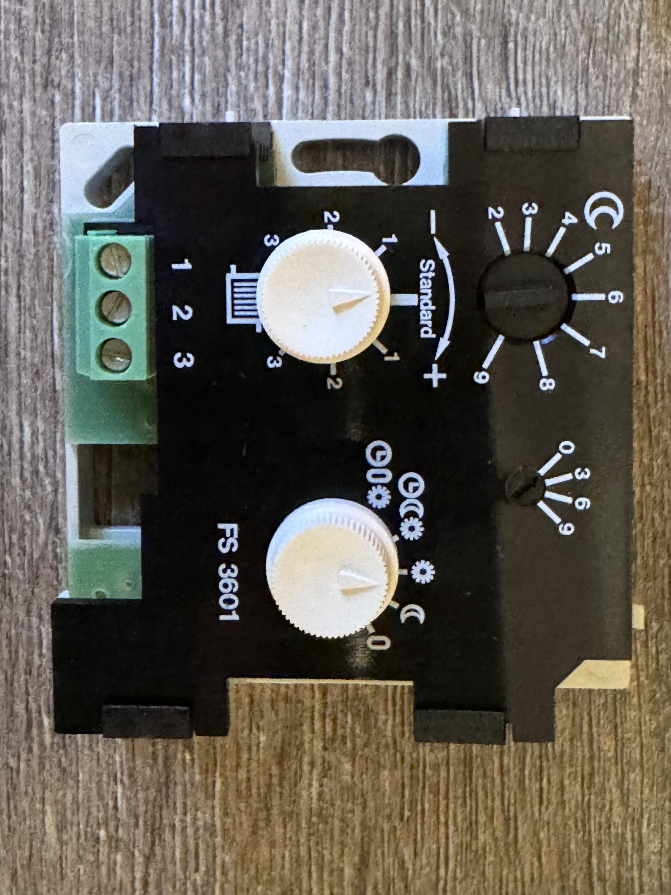
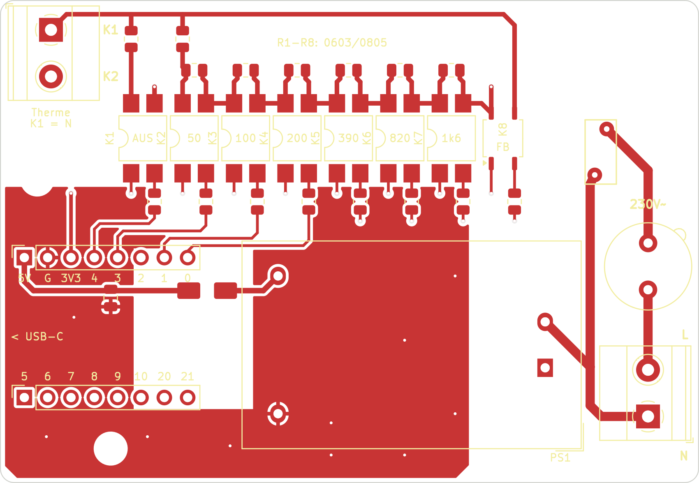
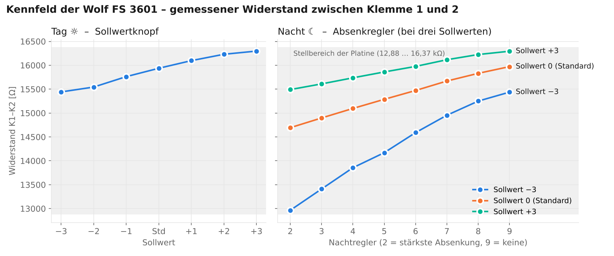

# ESPHome-Ersatz für den Wolf-Fernversteller FS 3601

Ein **ESP32-C3 mit ESPHome** ersetzt die analoge Fernbedienung **Wolf FS 3601** eines alten Wolf-Gaskessels (hier NG-2E-17, Baujahr 1993). Die Platine bildet den Widerstand zwischen den Kesselklemmen 1 und 2 nach, galvanisch getrennt über PhotoMOS-Relais. Damit kann **Home Assistant** die Heizkurve des Kessels stufenlos und **bedarfsgerecht** nachregeln, abhängig davon, was die einzelnen Räume tatsächlich brauchen.

| Original FS 3601 | Ersatzplatine FS3601-ESP |
|---|---|
|  |  |

## Was drin ist

| Ordner | Inhalt |
|---|---|
| [`docs/`](docs) | Dokumentation, Messwerte, Diagramme |
| [`fs3601/`](fs3601) | Reverse-Engineering der Original-FB: Fotos (nummerierte Lötaugen), Schaltplan |
| [`hardware/`](hardware) | KiCad-Platine, Gerber, Stückliste, Bestückungsdaten, Schaltplan, Generator-Skripte |
| [`firmware/`](firmware) | ESPHome-Konfiguration |
| [`home-assistant/`](home-assistant) | Automationen und Helfer für die bedarfsgerechte Heizkurve |
| [`tools/`](tools) | Hilfsskripte (Bildentzerrung, Diagramme) |

## Dokumentation

1. [Reverse-Engineering der FS 3601](docs/1_reverse_engineering.md): Netzliste, Schalterstellungen, Kennfeld
2. [Hardware](docs/2_hardware.md): Platine, Bestückung, galvanische Trennung, Inbetriebnahme, Kalibrierung
3. [Firmware](docs/3_firmware.md): Betriebsarten, Entitäten, Sicherheit
4. [Home Assistant](docs/4_home_assistant.md): bedarfsgerechte Heizkurve, Kesselschutz, erste Ergebnisse
5. [Messwerte](docs/5_messwerte.md): alle Messungen und Lehrgeld

## Kurzfassung

- Der Kessel misst nur den **Widerstand an Klemme 1–2**. Mit Raumeinfluss 0 erzeugt die FS 3601 Werte von **12,96 kΩ bis 16,30 kΩ** sowie 3,87 kΩ für „Aus“.
- Die Platine stellt **64 Widerstandswerte** von 12,88 bis 16,37 kΩ ein (Raster ≤ 70 Ω), über sechs PhotoMOS-Schließer (TLP240A) an einer Widerstandskette. Ein **PhotoMOS-Öffner** (CPC1117N) brückt K1–K2, wenn der ESP stromlos ist. Dann läuft der Kessel wie ohne Fernbedienung.
- Eigenes Netzteil (HLK-PM01) mit Sicherung und Varistor. Zum Kessel hin ist alles über die PhotoMOS getrennt (Klemme 1 liegt auf N).
- In Home Assistant regelt eine Automation die **Heizkurve 0–100 %** alle 10 Minuten nach Raumdefizit und Ventilstellung der Thermostate. Dazu kommt ein Kesselschutz über die Rücklauftemperatur.

## Warnung

Die Platine arbeitet mit **230 V Netzspannung**, und Klemme 1 des Kessels liegt auf dem Neutralleiter. Aufbau und Anschluss nur durch Personen mit entsprechender Qualifikation, nur spannungsfrei, in einem geschlossenen, flammgeschützten Gehäuse. Eingriffe in die Heizungsanlage geschehen auf eigene Verantwortung. Das Projekt ist ein privater Nachbau und steht in keiner Verbindung zu Wolf.

## Lizenz

Software (Firmware, HA-Automationen, Skripte): **MIT**. Hardware und Doku: **CERN-OHL-P-2.0**. Details in [`LICENSE`](LICENSE).

## Autor

Fabian Harder
