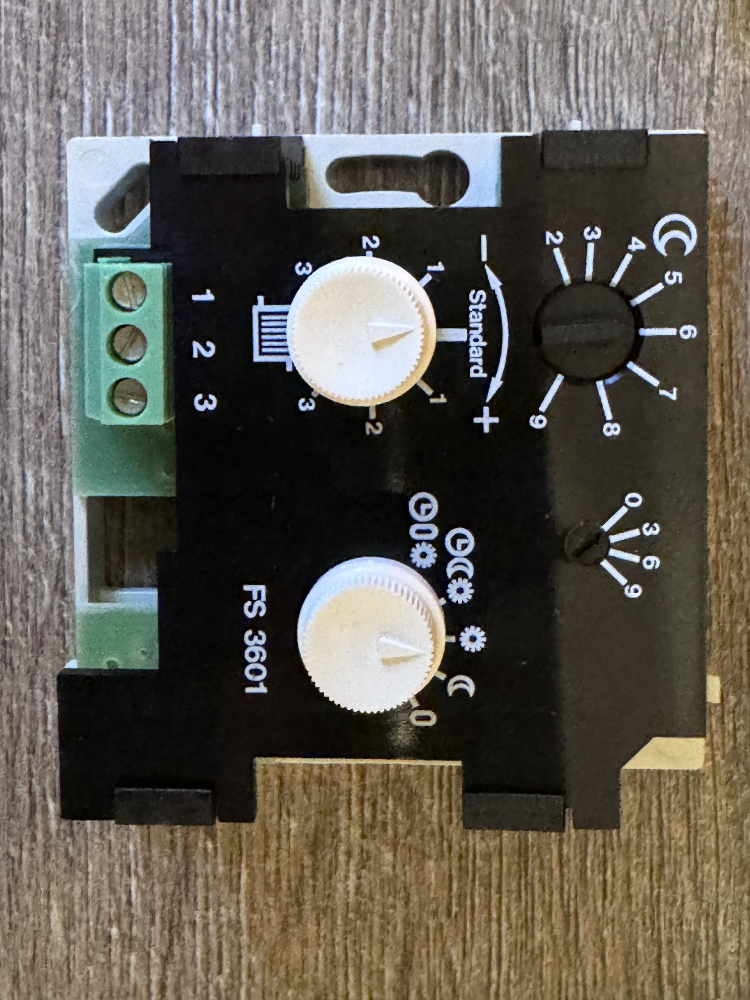
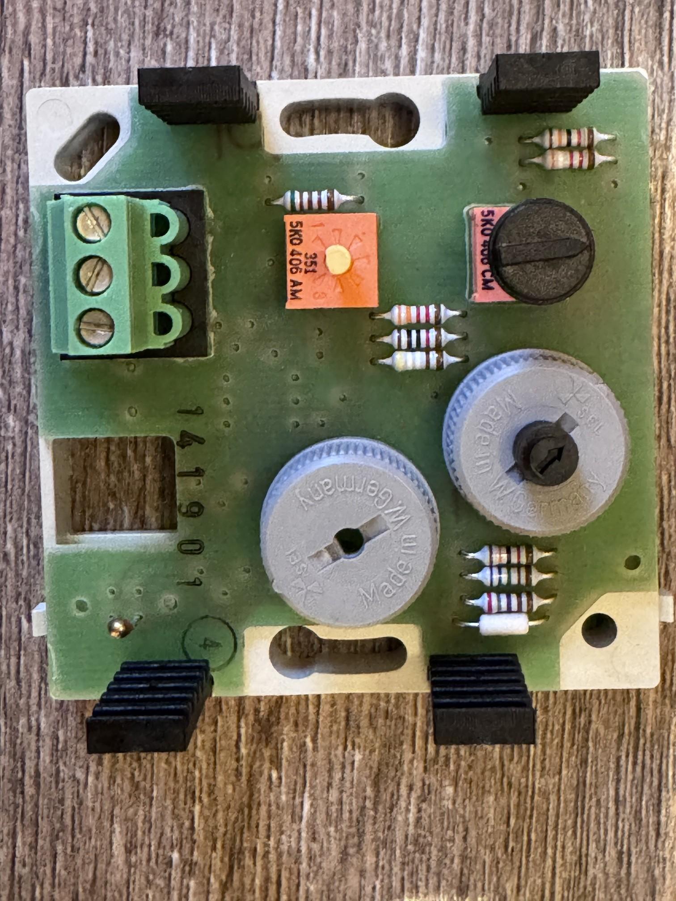
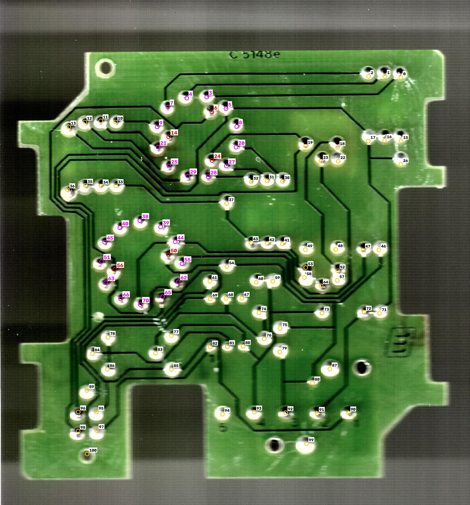
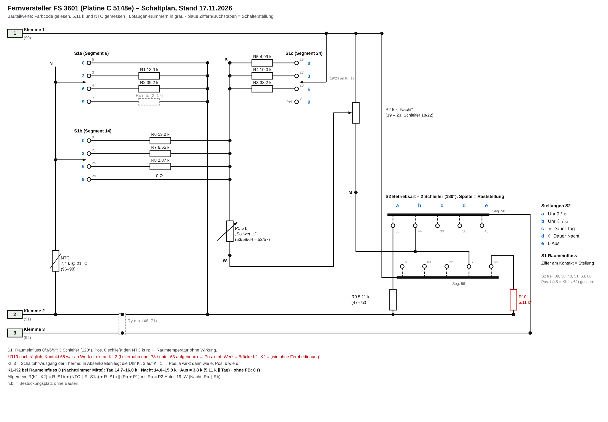
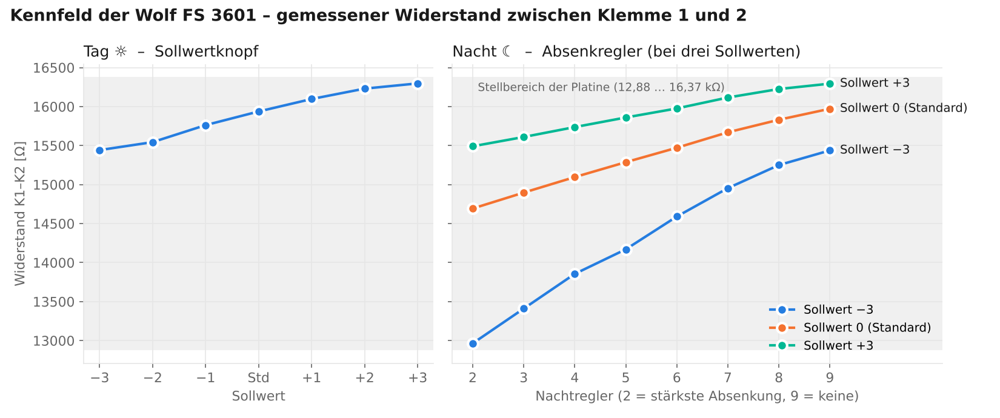

# 1 – Reverse-Engineering der Wolf FS 3601

Die FS 3601 ist ein rein **analoger Fernversteller** für Wolf-Kessel der frühen 1990er Jahre, bei mir an einer **NG-2E-17** (Gas-Spezialheizkessel nach DIN 4702 Teil 3, Baujahr 1993, 12–17 kW, kein Brennwert). Sie hängt mit drei Adern an den Klemmen 1, 2 und 3 des Kessels. Eine Datenleitung gibt es nicht. Der Kessel misst nur den **Widerstand zwischen Klemme 1 und 2**.

Bedienelemente:

- **Wahlschalter (S2):** Uhr 0/☼, Uhr ☾/☼, ☼ Tag, ☾ Nacht, 0 Aus
- **Sollwertknopf:** −3 … Standard … +3
- **Absenkregler (Nacht):** 2 … 9
- **Raumeinfluss (S1):** 0, 3, 6, 9 (innen, Drehschalter)

## Klemmen

| Klemme | Lötauge | Bedeutung |
|---|---|---|
| 1 | 90 | liegt im Kessel auf **N** |
| 2 | 91 | Messeingang |
| 3 | 92 | Ausgang der Kessel-Schaltuhr; nachts legt die Uhr Klemme 3 auf Klemme 1 |

Zwischen Klemme 1 und 2 liegen im Betrieb etwa **1,8 V AC**. Ohne Fernversteller wird **K1–K2 im Kessel gebrückt**, dann regelt der Kessel mit seinen eigenen Einstellungen („Therme intern“).

## Platine und Netzliste

Die Platine (Aufdruck C 5148e) habe ich von beiden Seiten fotografiert bzw. gescannt, die Fotos entzerrt, übereinandergelegt und alle Lötaugen nummeriert. Darauf beruht der Schaltplan.

| Bestückungsseite | Lötseite (Scan, nummeriert) |
|---|---|
|  |  |

Weitere Bilder liegen in [`fs3601/fotos`](../fs3601/fotos).

Der Schaltplan wird von [`fs3601/schaltplan/gen_schaltplan.py`](../fs3601/schaltplan/gen_schaltplan.py) als SVG erzeugt.

### Wichtige Bauteile

- **NTC** (Raumfühler) 7,4 kΩ bei 21 °C, zwischen Klemme 2 und N
- **S1 Raumeinfluss**, Drehschalter mit drei Ebenen (Segmente 6, 14, 24):

  | Stellung | Kontakte | Wirkung |
  |---|---|---|
  | 0 | 5, 9, 28 | NTC kurzgeschlossen, 13,0 k (N–X), 4,99 k (K1–X) |
  | 3 | 3, 21, 27 | |
  | 6 | 4, 25, 20 | |
  | 9 | 7, 29, 8 | Rx unbestückt, 0 Ω, frei |

- **S2 Betriebsart**, zwei Schleifer im Abstand von 180° (Segment 50 = K3, Segment 56 = K1):

  | Pos. | Blende | Verbindung |
  |---|---|---|
  | a | Uhr 0 / ☼ | K3 – 5,11 k – K2 |
  | b | Uhr ☾ / ☼ | K3 – M |
  | c | ☼ Tag | nichts verbunden |
  | d | ☾ Nacht | K1 – M |
  | e | 0 Aus | K1 – R10 5,11 k – K2 |

  Kontrollmessung in Stellung a: K1–K3 = 17 kΩ, also K1–K2 + 5,11 k.

Gesamtwiderstand: R(K1–K2) = R_S1b + (NTC ∥ R_S1a) + R_S1c ∥ (Ra + P1)

## Kennfeld

Mit **Raumeinfluss 0** ist der Raumfühler kurzgeschlossen. Der Widerstand hängt dann nur noch von den Knöpfen ab. Gemessen ist zwischen Klemme 1 und 2 bei abgeklemmter FB, mit demselben Messgerät wie später die Ersatzplatine.

Die Werte als Tabelle stehen unter [5 – Messwerte](5_messwerte.md). Daraus ergibt sich:

- **Tag:** 15 442 Ω (−3) bis 16 297 Ω (+3), nicht linear
- **Nacht:** Bei Absenkregler 9 entspricht die Nacht genau dem Tagwert. Je kleiner die Zahl, desto mehr wird abgezogen. Wie viel, hängt stark vom Sollwert ab: bei −3 bis zu 2,5 kΩ, bei +3 nur 0,8 kΩ.
- **Aus (Stellung 0):** 3 872 Ω
- **Gesamtbereich:** 12 964 Ω (−3, Nacht 2) bis 16 297 Ω (+3, Tag)

## Wie der Kessel den Wert nutzt

Der Kessel hat einen eigenen Außenfühler und regelt den Vorlauf nach einer Heizkurve. Der Widerstand der FS 3601 **verschiebt diese Kurve**, wirkt also wie ein Raumsollwert. Der Kessel unterscheidet dabei nicht zwischen „Tag“ und „Nacht“, für ihn zählt nur der Widerstandswert. Darauf baut die bedarfsgerechte Regelung auf, siehe [4 – Home Assistant](4_home_assistant.md).
