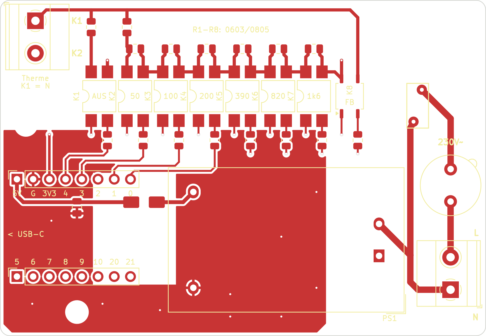
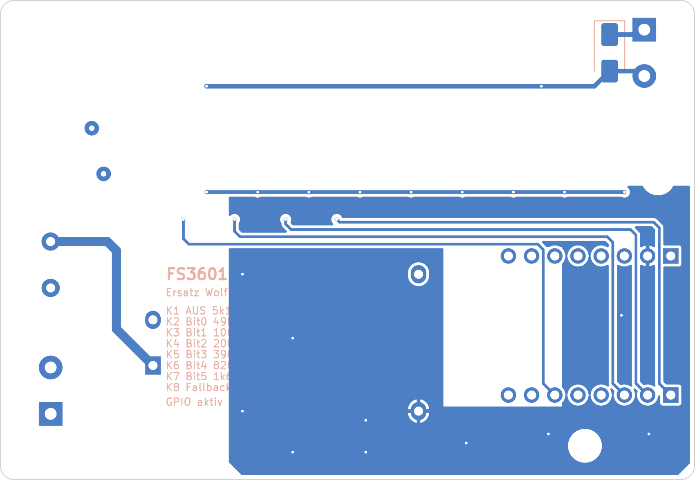
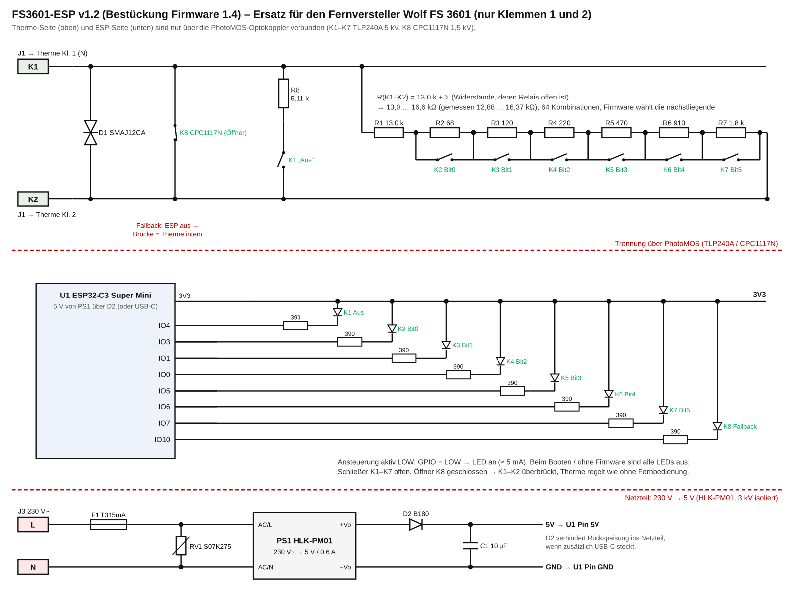

# 2 – Hardware: Platine FS3601-ESP v1.2

Ersatz für den analogen Fernversteller **Wolf FS 3601** an der NG-2E. Die Platine bildet zwischen den Thermen-Klemmen **1 und 2** den Widerstand nach, den die FS 3601 liefern würde. Gesteuert wird sie von einem **ESP32-C3 Super Mini** mit ESPHome. Klemme 3 (Schaltuhr der Therme) bleibt offen.

## Funktion

| Betriebsart (ESPHome) | K1–K2 | entspricht FS 3601 |
|---|---|---|
| Therme intern | ≤ 16 Ω (Öffner K8 geschlossen) | ohne Fernbedienung / Brücke |
| Automatik / Tag / Nacht / Test | 12,88 … 16,37 kΩ, 64 Kombinationen, Abstand ≤ 70 Ω | jede Knopfstellung ☼ / ☾ |
| Aus | Kette ∥ 5,11 kΩ = 3 872 Ω | Stellung „0“ |

Ist der ESP stromlos, startet er gerade neu oder ist abgestürzt, sind alle Relais-LEDs aus. Dann ist K8 geschlossen und die Therme läuft wie ohne Fernbedienung. Fehlt Home Assistant länger als 30 Minuten, schaltet die Firmware ebenfalls auf „Therme intern“ (Sensor „Rückfall aktiv“). Kommt HA zurück, gilt wieder die vorherige Betriebsart.

## Galvanische Trennung

Klemme 1 liegt auf dem N-Leiter der Therme. Therme-Seite (oben) und ESP-Seite (unten) sind nur über die PhotoMOS-Relais verbunden: K1–K7 (TLP240A) mit 5 kV, K8 (CPC1117N) mit 1,5 kV Isolationsspannung. Zwischen den Kontaktreihen gibt es eine 4 mm breite kupferfreie Sperrfläche. Kein Leiter der ESP-Seite darf mit der Therme verbunden werden. Das gilt auch für USB-Masse und Gehäuse.

## Bestückung

Stückliste: [`hardware/fertigung/FS3601-ESP_BOM.csv`](../hardware/fertigung/FS3601-ESP_BOM.csv). Alle Halbleiter sind SMD: Widerstände 0805, Dioden SMA, K1–K7 als DIP-4 mit Knickbeinen (TLP240A, „SOP-4“ beim Händler), K8 als echtes SOP-4 (CPC1117N). Alles lässt sich von Hand löten.

**R1–R8 (Kettenwiderstände) gehen als 0603 oder 0805.** Die Pads sind 0805-Pads, ein 0603 sitzt mit beiden Kappen darauf. Für Reflow mit Schablone besser 0805 nehmen.

- **K1–K7: TLP240A (Schließer), K8: CPC1117N (Öffner, kleines SOP-4 ganz rechts).** Nicht verwechseln mit TLP240G (50 Ω statt 2 Ω) oder CPC1017N (Schließer). Vor dem Einlöten ein Stück prüfen: Pin 1 über 1 kΩ an 5 V, Pin 2 an GND, dann Pin 3–4 messen. TLP240A: < 2 Ω, CPC1117N: offen (ohne LED-Strom < 16 Ω).
- Pin 1 der Relais liegt unten links. Die Kerbe im Bestückungsdruck zeigt nach links. **D1 (SMAJ12CA) sitzt auf der Unterseite**, alle anderen SMD-Teile oben; [`Bestueckungsplan.png`](../hardware/ansichten/Bestueckungsplan.png) zeigt die Lage aller Bauteile. Unter dem Super Mini liegen C1 und D2, sie werden vor den Buchsenleisten gelötet.
- Das Super Mini sitzt auf 2 × 8 Buchsenleisten, die USB-C-Buchse zeigt zur linken Platinenkante.

### Pinbelegung Super Mini prüfen

Die Platine geht von dieser Belegung aus, Bauteilseite oben und USB nach links:

```
obere Reihe:   5V  GND  3V3  IO4  IO3  IO2  IO1  IO0
untere Reihe:  IO5 IO6  IO7  IO8  IO9  IO10 IO20 IO21
```

Diese Beschriftung steht auch auf der Platine. Vergleich sie vor dem Einstecken mit dem Aufdruck auf deinem Modul.

- **Obere Reihe vertauscht** (5V/GND/3V3 liegen dann unten): Steck das Modul mit der Bauteilseite nach unten ein, dann stimmt alles.
- **Untere Reihe verkehrt herum** (IO21 links, IO5 rechts): Elektrisch ist das unkritisch, weil die Strapping-Pins IO8 und IO9 nicht benutzt werden. In der YAML-Datei änderst du dann nur K5 → GPIO21, K6 → GPIO20, K7 → GPIO10, K8 → GPIO7.

### Versorgung

Die Platine hat ein eigenes Netzteil: **PS1 HLK-PM01** (230 V~ → 5 V, 3 kV isoliert), angeschlossen an J3 (L/N, rechts unten). Davor sitzen **F1 T315 mA** und **RV1 S07K275**. D2 (B180 oder SS14) führt die 5 V zum Super Mini. Zum Flashen darf zusätzlich USB-C stecken, D2 verhindert dabei die Rückspeisung ins Netzteil.

**Netzspannung:**
- Anschluss nur spannungsfrei. Am besten hinter der Gerätesicherung der Therme oder an einem eigenen abgesicherten Abgang.
- Den Netzbereich (Aufdruck „ACHTUNG 230 V~“) nie im Betrieb berühren. Die Platine muss in ein **geschlossenes Kunststoffgehäuse** mit Zugentlastung für beide Kabel.
- Befestigung über 3 Bohrungen M3 (oben rechts, links oben unter J1, links unten). Für die Bohrung **oben rechts** (neben RV1, Netzbereich) eine **Kunststoffschraube** und einen Kunststoff-Abstandshalter verwenden.
- Abstände auf der Platine: Netz ↔ ESP-Seite ≥ 6,8 mm, Netz ↔ Therme-Seite ≥ 9,0 mm, Therme-Seite ↔ ESP-Seite 5,6 mm an K1–K7 und 4,0 mm an K8 (SOP-4-Gehäuse).
- **Klemme 1 der Therme liegt auf N.** Das Netzteil darf deshalb nicht zwischen L und Klemme 1 der Therme hängen, nimm L/N direkt aus der Zuleitung.

## Fertigung

[`FS3601-ESP_Gerber.zip`](../hardware/fertigung/FS3601-ESP_Gerber.zip) direkt bei JLCPCB, PCBWay o. ä. hochladen: 2 Lagen, 1,6 mm, 76 × 52,5 mm, keine Sonderoptionen. Mindestwerte: Leiterbahn 0,3 mm, Abstand 0,2 mm, Via 0,6/0,3 mm.
`hardware/fertigung/FS3601-ESP_pos.csv` ist die Bestückungsdatei, falls du die SMD-Teile bestücken lässt.
`hardware/kicad/FS3601-ESP.kicad_pcb` lässt sich mit KiCad 7 oder neuer öffnen. Der DRC ist ohne Fehler. Erzeugt wird die Platine von [`hardware/skripte/gen_pcb.py`](../hardware/skripte/gen_pcb.py). Die Masse-Fläche ist gefüllt; nach Änderungen in KiCad Taste B drücken.

## Inbetriebnahme

1. **Ohne Therme:** ESPHome flashen, dann mit dem Multimeter an J1 messen, jeweils in beiden Polungen.
   - „Therme intern“ und stromlos: unter 16 Ω (gemessen ≈ 4 Ω)
   - „Test (Widerstand)“ 12 000: Basis `r0`; 17 000: alle Bits offen
   - Einzelne Bits: Testwert so wählen, dass im Log `Kombi=1, 2, 4, 8, 16, 32` steht, Differenz zur Basis = `rbit[i]`
   - „Aus“: 3 872 Ω (gemessen 3,66 kΩ mit der alten Bestückung)
2. **An der Therme:** FS 3601 abklemmen und J1 an Klemme 1 und 2 anschließen. Klemme 3 bleibt frei, die Polarität ist egal.
3. **Kennfeld:** Die Firmware enthält das Kennfeld meiner FS 3601. Wer eine andere Original-FB hat, misst sie wie in [5 – Messwerte](5_messwerte.md) beschrieben aus.

### Bit-Widerstände und Genauigkeit

Die erste Bestückung (49,9 / 100 / 200 / 390 / 820 / 1600 Ω, Platinenaufdruck) deckte nur etwa 3,1 kΩ ab. Die Original-FB braucht aber **3,33 kΩ** (12 964 … 16 297 Ω). Deshalb sind die Bits jetzt etwas größer, alles E24-Werte:

| Bit | R | Relais | gemessen* |
|---|---|---|---|
| 0 | R2 68 Ω | K2 | 68 Ω |
| 1 | R3 120 Ω | K3 | 120 Ω |
| 2 | R4 220 Ω | K4 | 215 Ω |
| 3 | R5 470 Ω | K5 | 458 Ω |
| 4 | R6 910 Ω | K6 | 884 Ω |
| 5 | R7 1,8 kΩ | K7 | 1 727 Ω |

*als Differenz zur Basis, auf der Platine gemessen

Die Bits sind keine exakten Zweierpotenzen. Die Firmware sucht deshalb unter allen 64 Kombinationen die, die dem Ziel am nächsten kommt. Der größte Fehler liegt bei ±35 Ω, die kleinste Knopfstufe der FB beträgt 67 Ω. Die Platinenaufdrucke „50 100 200 390 820 1k6“ unter den Relais gelten für diese Bestückung nicht mehr.

**R1 vor dem Einlöten ausmessen.** Die Basis (alle Bits überbrückt) muss zwischen 12 809 und 12 964 Ω liegen, sonst ist ein Ende des Bereichs nicht erreichbar. Bei mir hatte der erste „13 k“ nur etwa 12,6 kΩ. Ziel für R1 lose gemessen: **12,86 – 12,97 kΩ**, notfalls mit einem parallel aufgelöteten Widerstand im MΩ-Bereich korrigieren.

### Messen auf der Platine: beide Polungen!

Ist K8 offen, also seine LED an, erzeugt der CPC1117N einen kleinen **Fotostrom von etwa 80–90 nA** am Ausgang. An K1–K2 liegen dann je nach Widerstand 0,3–1,3 mV Gleichspannung. Ein Ohmmeter misst damit **je nach Polung ±100 Ω falsch**. Für die Therme spielt das keine Rolle, sie misst mit 1,8 V AC. Für die Kalibrierung gilt aber: **jeden Wert in beiden Polungen messen und mitteln.**

| Polung A | Polung B | Mittel |
|---|---|---|
| 12 991 | 12 775 | **12 883** (Basis, Test 12 000) |
| 16 234 | 16 507 | **16 371** (alle offen, Test 17 000) |
| 15 833 | 16 105 | **15 969** (Tag / Sollwert 0, Soll 15 937) |

Die Mittelwerte stehen als `r0` und `rbit[]` in der Firmware.

## Klemmen

J1 und J3 sind Phoenix SPTH 1,5/2-5,08 (Push-in, Leiter von oben, 13,75 mm hoch). Auf dieselben Pads passen auch MKDS 1,5/2-5,08 oder PTR AKL 101-02 (Schraubklemmen, RM 5,08).

## Gehäuse

Hinweise zur Wahl: Kunststoff, flammgeschützt (Glühdraht 650 °C oder besser), Innenmaß mindestens etwa 80 × 57 × 30 mm. Passend ist z. B. die Abzweigdose **Hensel DK 0400 G** (Einbauraum 83 × 83 × 55 mm). Die kleinere DK 0200 G (74 × 74 mm) ist zu klein. Die Platine sitzt auf einer kleinen Montageplatte mit drei M3-Abstandshaltern.

## Ansichten

| Oben | Unten (gespiegelt) |
|---|---|
|  |  |


