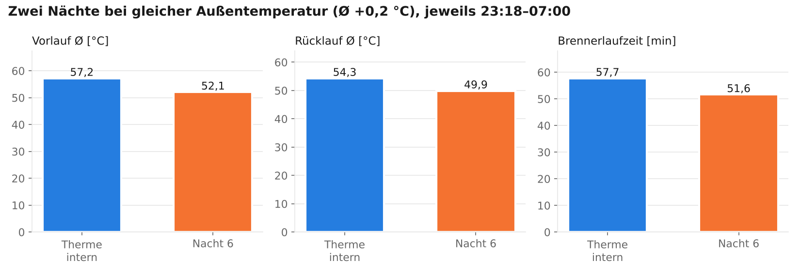

# 4 – Home Assistant: bedarfsgerechte Heizkurve

## Idee

Tag- und Nachtbetrieb sind ein Relikt der alten Fernbedienung. Der Kessel kennt nur **einen** Wert: den Widerstand an K1–K2. Daraus und aus seinem Außenfühler bildet er die Vorlauftemperatur. Statt zwei Modi gibt es hier deshalb **eine stufenlose Heizkurve**, die ständig nach dem tatsächlichen Bedarf der Räume nachgeregelt wird.

```
Außentemperatur ──► Kessel (eigene Witterungsführung) ──► Vorlauf
                          ▲
                          │ Heizkurve 0–100 %  (12,96 – 16,30 kΩ)
                          │
     HA-Regler: Räume unterversorgt?   → Kurve rauf (schnell)
                alle satt, Ventile zu? → Kurve runter (langsam)
                Rücklauf zu kalt?      → nicht weiter runter (Kesselschutz)
```

- Den groben Teil, die Anpassung an die Außentemperatur, macht der Kessel selbst. HA trimmt nur.
- Die Räume sagen, was sie brauchen. Jede Heizung hat einen Versatile Thermostat (VTherm) mit TRV und Ventilstellung. Zeitpläne, Eco, Abwesenheit und Fensterkontakte wirken über die Raumsollwerte. Eine „Nachtabsenkung“ entsteht damit automatisch: Senken die Räume nachts ab, fällt der Bedarf, und der Regler fährt die Kurve herunter.

## Bausteine

| Baustein | Datei |
|---|---|
| Regler (alle 10 min) | [`automationen/heizkurve_bedarfsgerecht_regeln.yaml`](../home-assistant/automationen/heizkurve_bedarfsgerecht_regeln.yaml) |
| Betriebsart (Automatik / Frostschutz → Aus) | [`automationen/therme_betriebsart.yaml`](../home-assistant/automationen/therme_betriebsart.yaml) |
| Helfer (Raumauswertung, Rücklauf-Mittel) | [`helfer/README.md`](../home-assistant/helfer/README.md) |

## Regelregeln

Der Regler greift nur in der Betriebsart **Automatik**.

**Kurve +2 %**, wenn eine der Bedingungen zutrifft:
- mindestens 2 Räume unterversorgt, also mehr als 0,5 K unter Soll bei Ventil ≥ 80 %
- 1 Raum unterversorgt und dabei mehr als 1 K Defizit
- Kesselschutz: Rücklauf-Mittel (30 min) unter 43 °C, während der Brenner läuft

**Kurve −0,5 %**, wenn alle Bedingungen zutreffen:
- kein Raum unterversorgt
- alle Ventile unter 60 %
- kein Raum mehr als 0,3 K unter Soll
- Rücklauf-Mittel über 47 °C

Rauf geht es also schnell, runter langsam, maximal etwa 3 % pro Stunde.

## Kesselschutz (NG-2E)

Die NG-2E ist ein **konventioneller Kessel, kein Brennwertgerät**. Läuft er dauerhaft zu kalt, kondensiert das Abgas im Wärmetauscher und Schornstein, das führt zu Korrosion und Versottung. Als Faustwert gilt eine Untergrenze von etwa 40–45 °C Rücklauf. Eine Herstellerangabe für die NG-2E habe ich nicht gefunden. Der Regler hält deshalb 47 °C als Absenkgrenze und hebt unter 43 °C bei laufendem Brenner wieder an.

## Erste Ergebnisse

Noch vor der Automatik lief eine Nacht mit fester Absenkung (FB-Skala Nacht 6, Sollwert 0) gegen eine Nacht „Therme intern“, bei gleicher Außentemperatur:



- Vorlauf −5,1 K, Rücklauf −4,4 K
- **Brennerlaufzeit −10,6 %**
- Takte etwa gleich (27 zu 28). Bei 12 kW Mindestleistung und 7,8 l Wasserinhalt verlängern sich nur die Pausen.

Am Tag lagen die meisten Räume 1–4 K über ihrem Soll, bei geschlossenen Ventilen. Die Werkseinstellung des Kessels war also deutlich zu hoch. Genau hier setzt die Automatik an.
